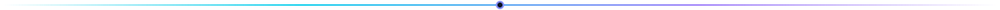
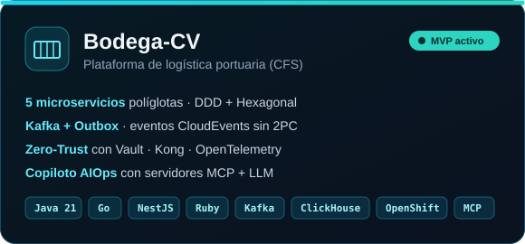
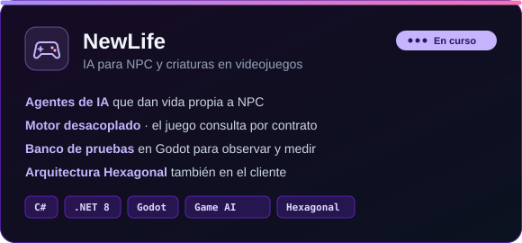
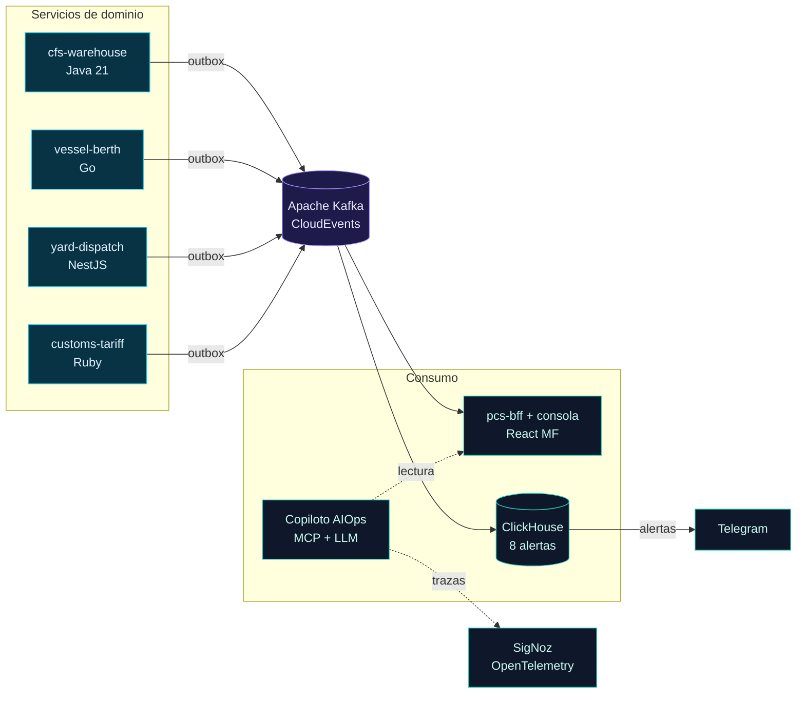

<p align="center">
  
</p>

<p align="center">
  <a href="https://git.io/typing-svg"></a>
</p>

<p align="center">
  <a href="https://www.linkedin.com/in/sergio-pino-lagos-07b465a2/"></a>
  
  
</p>



## 👨‍💻 Sobre mí

Ingeniero en Informática con más de **9 años** diseñando plataformas de alto tráfico: iGaming y pagos 24/7, y logística omnicanal para retail regional (Chile, Perú y Colombia).

Trabajo con **microservicios orientados a eventos** sobre **DDD y Arquitectura Hexagonal**, con patrones como **Transactional Outbox, CQRS y Sagas**. Me ocupo de que la plataforma sea segura (**Zero-Trust, HashiCorp Vault**), observable de extremo a extremo (**OpenTelemetry**) y operable con ayuda de agentes de IA (**Model Context Protocol, LLMs**).

```yaml
sergio:
  rol: [Software Architect, Senior Backend Engineer, Tech Lead]
  dominio: [iGaming, pagos, retail omnicanal, logística portuaria]
  patrones: [EDA, DDD, Hexagonal, CQRS, Outbox, Sagas]
  ahora: [Bodega-CV, NewLife]
  idiomas: { español: nativo, inglés: profesional }
```


## 🚀 Proyectos actuales

<p align="center">
  
  
</p>

<details>
<summary><b>⚓ Ver la arquitectura de eventos de Bodega-CV</b></summary>
<br/>



</details>


## 🧰 Stack

<p align="center">
  <br/>
  <br/>
  <br/>
  
</p>

<p align="center">
  
  
  
  
  
  
  
  
  
  
</p>


## 🧭 Trayectoria

<p align="center">
  
</p>


<p align="center">
  <b>¿Conversamos sobre arquitectura, eventos o agentes de IA?</b><br/>
  <a href="https://www.linkedin.com/in/sergio-pino-lagos-07b465a2/">Escríbeme por LinkedIn</a>
</p>
